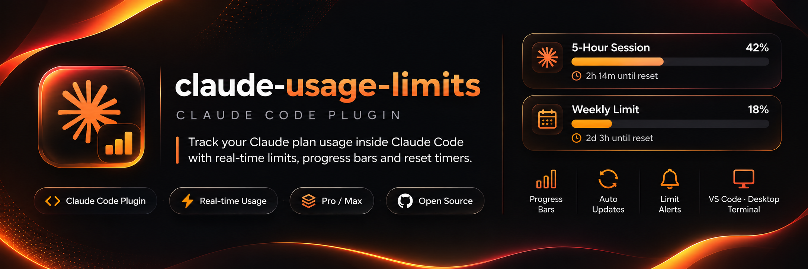
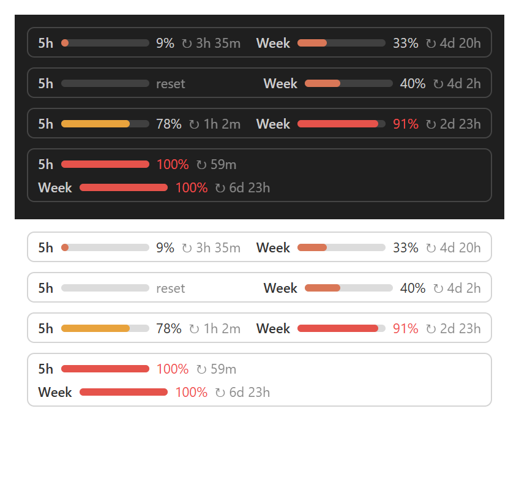

# Claude Usage Limits: a Claude Code plugin to track your 5-hour and weekly limits


**Check your Claude usage and see how much of your Claude limit is left, without leaving Claude Code.** This plugin shows your **5-hour session limit** and your **weekly limit** as progress bars right above the prompt box, with a countdown to when each Claude limit resets. It works with Claude Pro and Claude Max plans in VS Code, the desktop app and the terminal.

**Website:** [sakithasamarathunga33.github.io/claude-usage-limits](https://sakithasamarathunga33.github.io/claude-usage-limits/)



*A preview of the bars in VS Code and the desktop app, and the line the terminal shows, in dark and light themes. The second row has the chime muted (🔕). The figures are examples.*

- Bars turn **amber at 75%** and **red at 90%**.
- The figures update as you use Claude, and the countdown refreshes every minute.
- A new session shows your last known figures straight away, then switches to live ones after its first reply.
- When Claude finishes a task you hear a short chime, even while you are in another window, and get a notification. You can mute the chime.
- It works in every project once installed.

## What you need

- A **Claude Pro or Max** subscription. API-key logins have no plan limits, so there is nothing to show.
- **Claude Code**, signed in. Tested with versions 2.1.316 and 2.1.319.
- **Git**, which Claude Code uses to download the plugin.

Where you see it:

| Where you use Claude Code | What you get |
| --- | --- |
| VS Code extension | Progress bars above the prompt |
| Desktop app | Progress bars above the prompt |
| Terminal | A line under the prompt: `5h ▰▰▰▰▱▱▱▱▱▱ 42% ↻ 2h14m │ Week ▰▰▱▱▱▱▱▱▱▱ 18% ↻ 2d3h │ 🔔` |

## Install

Run this one command in PowerShell on Windows or Terminal on Mac, or paste it to Claude and ask it to run it. There is nothing to download or clone yourself.

```bash
claude plugin install usage --marketplace SakithaSamarathunga33/claude-usage-limits
```

Then open a new Claude session. In VS Code, you can also press `Ctrl+Shift+P` (`Cmd+Shift+P` on Mac) and run **Developer: Reload Window**.

In a terminal session of Claude Code, you can type it at the prompt instead. Answer `y` to add the marketplace, then press Enter to install it for your user account.

```text
/plugin install usage --marketplace SakithaSamarathunga33/claude-usage-limits
```

## Using it

The bars appear on their own after your first reply on a new computer. After that they show as soon as you open a session.

Type `/limits` in Claude Code for a more detailed view.

### When a task finishes

Each time Claude finishes replying, the plugin plays a short chime and shows a notification such as **Task finished (42s)**: your terminal's own notification where it has one, otherwise a small pop-up inside Claude Code.

It stays quiet when you interrupt Claude yourself, and for the background helpers Claude starts during a task.

### Muting the chime

| Type this | What it does |
| --- | --- |
| `/limits mute` | Turns the chime off. The notification still shows. |
| `/limits unmute` | Turns the chime back on. |
| `/limits` | Shows the detailed view of your limits. |

The bell at the end of the bars shows the current setting: 🔔 on, 🔕 muted. In VS Code and the desktop app, click the bell to switch it. The setting is shared by every Claude Code window and terminal, and kept for new sessions. A change made in another window shows on the bell within a minute.

## Update

Run these on Windows or Mac:

```bash
claude plugin marketplace update claude-usage-limits
claude plugin update usage@claude-usage-limits
```

Then open a new Claude session.

### Upgrading from version 0.1.0

The plugin was renamed from `usage-limits` to `usage` in version 0.2.0, so the update command above cannot find an older install. Reinstall it once:

```bash
claude plugin uninstall usage-limits@claude-usage-limits
claude plugin marketplace update claude-usage-limits
claude plugin install usage@claude-usage-limits
```

Then open a new Claude session. Your last saved figures are not carried over, so the bars return after your first reply.

## Uninstall

```bash
claude plugin uninstall usage@claude-usage-limits
claude plugin marketplace remove claude-usage-limits
```

## Troubleshooting

| What you see | What to do |
| --- | --- |
| Nothing shows after installing | Open a new session and send one message. The first figures arrive with the first reply. |
| The bars disappeared after pressing `[-]` | That collapses them. Press `ctrl+x`, then `ctrl+a`, to bring them back, or start a new session. |
| A line of text instead of bars in VS Code or the desktop app | Your version of Claude Code is not drawing the bars there. Update Claude Code. The text line shows the same figures. In the terminal the line under the prompt is expected. |
| No chime when a task finishes | Check that the bell shows 🔔, not 🔕. If it is muted, type `/limits unmute`. On Windows, also check the volume of *System sounds* in the Volume Mixer. |
| `/limits` says "Unknown option" | Only `/limits`, `/limits mute` and `/limits unmute` exist. |
| `/limits` says "No usage-limit reading yet" | Send one message first. If it stays, check that you are signed in with a Pro or Max plan and not an API key. |
| `/limits` is an unknown command | Update Claude Code, then open a new session. |
| The install fails to download | Check that `git --version` works. If it doesn't, install Git from [git-scm.com](https://git-scm.com/downloads), open a new terminal and try again. |
| A limit shows "reset" | That limit has reset. The new figure arrives with your next reply. |

## FAQ

### How do I check my Claude usage limit in Claude Code?

Install this plugin with the command in [Install](#install). Your 5-hour and weekly Claude usage then shows as progress bars above the prompt. Type `/limits` for a detailed view.

### How do I see when my Claude limit resets?

Each bar ends with a countdown, such as `↻ 2h14m` for the 5-hour limit or `↻ 2d3h` for the weekly limit. It refreshes every minute.

### Does it show the weekly limit as well as the 5-hour limit?

Yes. Both the 5-hour session limit and the weekly limit are shown side by side, each with its own percentage and reset time.

### Which plans does it work with?

Claude Pro and Claude Max. If you sign in to Claude Code with an API key there are no plan limits, so there is nothing to show.

### Does it work in VS Code?

Yes. In the Claude Code VS Code extension and the desktop app you get progress bars above the prompt. In the terminal you get a one-line summary under the prompt.

### Is it free?

Yes. It's open source under the MIT license.

## Privacy

The plugin only reads the usage figures Claude Code already has. It makes no network requests of its own and does not touch your login. The last reading is saved in Claude Code's own plugin storage on your computer, so a new session has something to show. Your mute setting is saved in `~/.claude/plugins/usage-settings.json`.

On Windows it runs PowerShell on your computer to play the chime. It runs nothing else.

## Good to know

This plugin uses Claude Code's early-access plugin API, which may change between releases. If an update stops it from working, check this repository for a newer version.

## Development

Run the tests and checks from the repository folder:

```bash
claude plugin test .
claude plugin validate .
```
